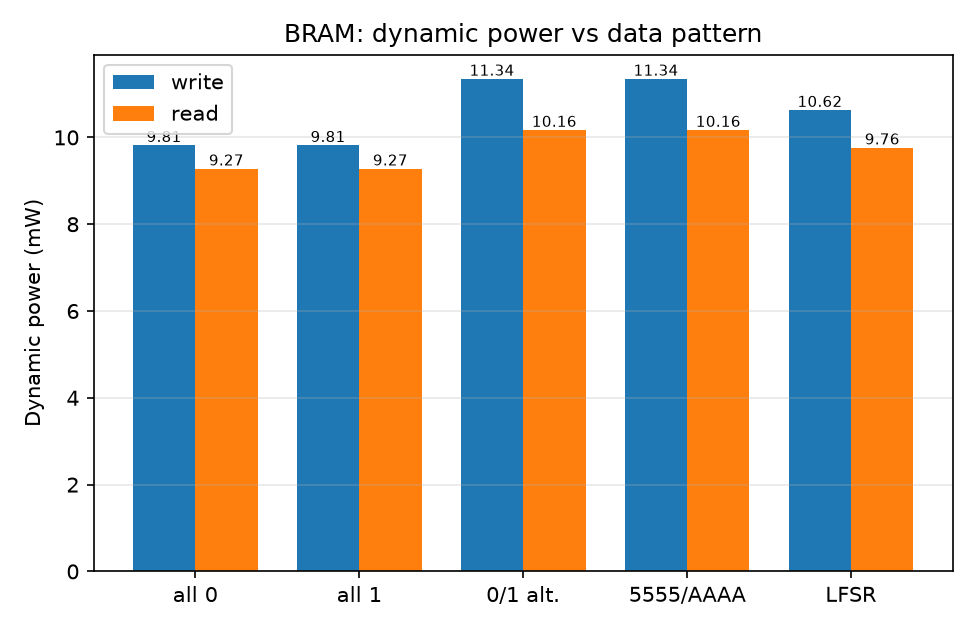
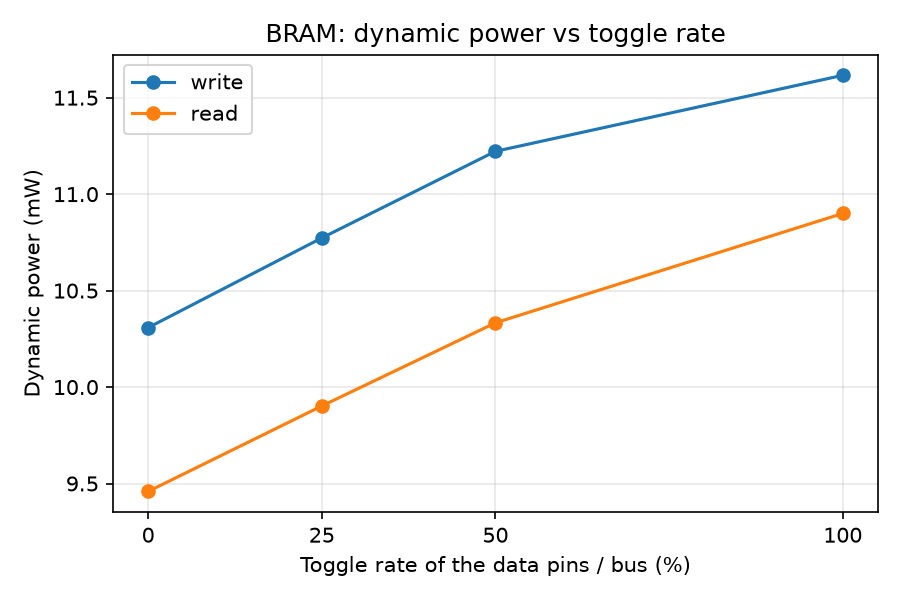
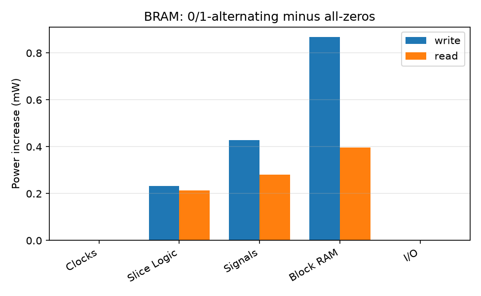
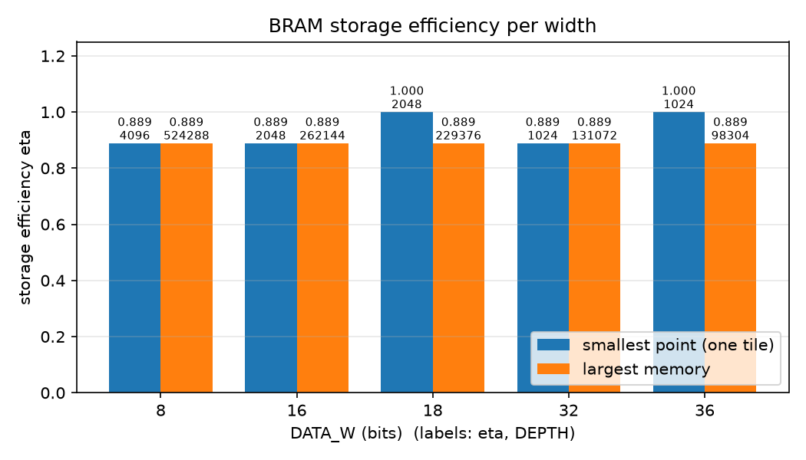
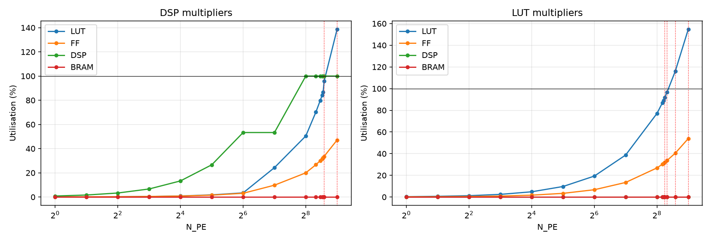
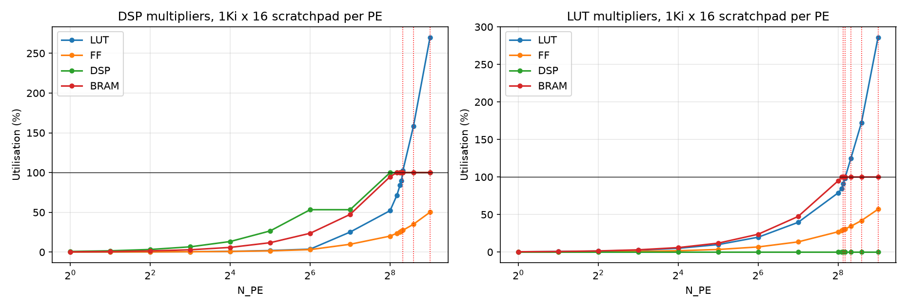

# ELCT918 – Lab Assignment 7: DDR2, Block RAM, Power and Design Space Exploration

Target: **Nexys 4 DDR**, Artix-7 **xc7a100tcsg324-1**, Vivado **2018.2** (MIG v4.1, Clocking Wizard v6.0).

This folder is the complete submission of Lab 7. Everything that does not need the
physical board has been done here (RTL, testbenches, simulations, implementation,
power analysis, the two design space explorations, tables and plots). The few
steps that need the board are listed at the end in
[Instructions for the board run](#instructions-for-the-board-run-teammate).

## Status at a glance

| Task | Part | Status |
|---|---|---|
| 1 | MIG `ddr` + `clk_wiz_0` + `ram2ddr_fixed.vhd` + own top `ddr_top` | RTL done; build script `scripts/build_ddr.tcl` (see the MIG note below) |
| 1 | `ddr_ctrl` traffic controller with the 4-phase `ram_ack_o` handshake | done, verified in simulation (through the BRAM adapter) |
| 1 | Full 128 MiB run + PASS / error count on LEDs / 7-seg | **board** |
| 1 | Cycle counts of one write and one read pass → bandwidth | **board** (display shows the counts) |
| 2 | Parameterized `bram`, self-checking testbench | done – **PASS** (4112 / 4112 checks, 32×4096 and 16×4096) |
| 2 | Controller reused on a 4096 × 32 BRAM, LEDs | bitstream `bitstreams/bram_top.bit` built; **board** run to confirm |
| 2 | BRAM bandwidth | 3 cycles / word → **133.3 MB/s** (simulation; board confirms) |
| 3 | BRAM power: 10 SAIF cases + toggle sweep | done (100 % nets matched, confidence High) |
| 3 | DDR2 power: `set_switching_activity` per pattern + toggle sweep | script `scripts/power_ddr.tcl` ready, runs on the routed DDR design |
| 3 | Bonus: DRAM chip power (TN-47-04) | done (`results/task3_dram_power_tn4704.md`) |
| 4.1 | Maximum initialised BRAM for W = 8, 16, 18, 32, 36 | done: 4096 / 4096 / 4032 / 4096 / 3456 Kb (`results/task4_bram_sweep.md`) |
| 4.2 | Maximum N_PE, DSP and LUT multipliers, + 1 Ki × 16 scratchpad | done: 376 (DSP), 296 (LUT), 270 with a BRAM scratchpad (`results/task4_pe_sweep.md`) |

---

## 1. Folder structure and what every file does

```
Lab7 assignment/
├── rtl/            synthesizable sources
├── sim/            testbenches
├── constraints/    XDC files (one per top level)
├── ip/             MIG project file (mig.prj)
├── mem/            $readmemh init files
├── scripts/        Tcl / batch / Python automation
├── reports/        raw Vivado .rpt files (task1 … task4)  ← submitted
├── results/        tables (.md / .csv), plots (.png), simulation logs
├── bitstreams/     .bit files for the board
└── build/          Vivado projects, checkpoints, SAIF files (NOT submitted, see .gitignore)
```

### rtl/

| File | Purpose |
|---|---|
| `ram2ddr_fixed.vhd` | Digilent SRAM-to-MIG wrapper from the tutorial (unchanged). Turns an asynchronous-SRAM style port (`ram_a`, `ram_dq_i/o`, `ram_cen/oen/wen`) into MIG native commands, one 16-bit word per BL8 burst, and raises `ram_ack_o` when the access is done. |
| `eyeriss_v2_pe.v` | Our Lab 5 PE (unchanged): 3-stage pipeline, two 8×8 signed multipliers (w0 = weight[7:0], w1 = weight[19:12]) gated by `csc_match_en`, 20-bit accumulators, 40-bit `psum_out`. |
| `eyeriss_v2_pe_dsp.v`, `eyeriss_v2_pe_nodsp.v` | Generated copies of the PE with `(* use_dsp = "yes" / "no" *)` on the module (made by `scripts/gen_pe_variants.py`). The attribute has to sit on the module that contains the `*`; putting it on a wrapper does not propagate. |
| `lfsr.v` | 32-bit Galois LFSR (taps 0x80200003), load / enable inputs. Used as pseudo-random data source everywhere. |
| `ddr_ctrl.v` | **The traffic controller** (Tasks 1, 2, 3). Writes a selectable pattern to every word of `[a_start, a_end]`, reads it back and counts mismatches, using only the 4-phase handshake on `mem_ack` (no fixed waits). Modes: 0 = test (write pass, read pass, stop), 1 = write forever, 2 = prefill then read forever. Patterns: 0 address hash, 1 zeros, 2 ones, 3 0/1 alternating per word, 4 5555/AAAA, 5 LFSR. Counts the clock cycles of the last complete write and read pass (40-bit), the number of passes, has a timeout state if an ack never comes. |
| `ddr_top.v` | Task 1 / Task 3 DDR2 top: `clk_wiz_0` (200 MHz for the MIG, 100 MHz for the logic) → `ram2ddr` → 2-flop synchronizers on `ram_ack_o` and `calib_o` → `ddr_ctrl` (16 bit, 2^26 words) → `board_status`. |
| `bram.v` | Task 2 parameterized block RAM: `DATA_W`, `DEPTH`, `INIT_FILE`, `(* ram_style = "block" *)`, `$readmemh` preload, registered read-first output. |
| `bram_top.v` | Task 2 / Task 3 BRAM top: the **same** `ddr_ctrl` drives a 4096 × 32 `bram` through a one-flop ack adapter that produces the same 4-phase handshake as `ram2ddr` (3 clock cycles per access). |
| `board_status.v` | LED and 7-segment mapping shared by both tops (see the board instructions). |
| `seg7_hex.v` | 8-digit multiplexed hex display driver. |
| `bram_dse_top.v` | Task 4.1 top: one `bram(DATA_W, DEPTH, "dse_init.mem")`, LFSR write data, address counter, output XOR-folded onto the LEDs so nothing is optimized away. |
| `pe_array.v` | Task 4.2 top: `N_PE` PEs in a generate loop, one LFSR per PE (different seeds), registered XOR-reduction tree of all 40-bit outputs into the LEDs; `USE_DSP` selects the PE variant, `SPAD = 1` adds a private 1 Ki × 16 BRAM scratchpad per PE. Reset and scratchpad address are distributed through a registered tree (one flop per 16 PEs, then one per PE). |

### sim/

| File | Purpose |
|---|---|
| `tb_bram.v` | Self-checking testbench of `bram`: checks every preloaded word, write-then-read at several addresses, read-first behaviour (old data appears during a write), neighbours undisturbed, `en = 0` holds the output. Prints `PASS` / `FAIL`. |
| `tb_bram_top.v` | Runs `bram_top` (controller + BRAM) for patterns 0–5 and once with one injected corrupted word; prints errors, cycles per pass, cycles per word and MB/s. |
| `tb_power.v` | Testbench for the post-implementation **netlist** of `bram_top`, used for the SAIF runs (mode and pattern from `+MODE=` / `+PAT=` plusargs). |

### constraints/

| File | Purpose |
|---|---|
| `ddr_top.xdc` | 100 MHz clock (E3), CPU_RESET (C12), SW[7:0], LED[15:0], 7-seg pins, false paths for the asynchronous switches / LEDs and for the clock-domain crossings into and out of `ram2ddr`. DDR2 pins are constrained by the MIG. |
| `bram_top.xdc` | Same board pins without the DDR2. |
| `bram_dse.xdc`, `pe_array.xdc` | Clock, reset, LEDs (and one switch for `bram_dse`) for the sweeps. |

### ip/, mem/

| File | Purpose |
|---|---|
| `ip/mig.prj` | MIG 7-series project with the tutorial settings (table in Task 1). Fed to the MIG with `CONFIG.XML_INPUT_FILE`. |
| `mem/bram32_init.mem`, `mem/bram16_init.mem` | Preload files for the 4096-deep BRAM, generated by `gen_init.py`. |
| `mem/init_tutorial.mem` | The tutorial's example init file. |

### scripts/

| File | Purpose / how to run (always from the `Lab7 assignment` folder) |
|---|---|
| `build_ddr.tcl` | Creates `build/ddr_proj`, generates `clk_wiz_0` and the MIG `ddr`, synthesizes, implements, writes `bitstreams/ddr_top.bit`, the Task 1 reports and `build/ddr_top_routed.dcp`. `vivado -mode batch -source scripts/build_ddr.tcl` (or `source` it in the Vivado Tcl console). |
| `build_bram.tcl` | Same for `bram_top` (project `build/bram_proj`, testbenches in sim_1): reports in `reports/task2`, `bitstreams/bram_top.bit`, routed checkpoint and the funcsim netlist for the SAIF runs. |
| `run_rtl_sims.bat` | Compiles and runs `tb_bram` (32×4096 and 16×4096) and `tb_bram_top` with xsim; logs in `results/sim_*.log`. |
| `power_bram_sims.bat` | Post-implementation functional simulation of the routed `bram_top` netlist, one run per operation × pattern, writing `build/saif/bram_<op>_<pattern>.saif`. |
| `power_bram.tcl` | Opens the routed BRAM design, reads each SAIF, `report_power` → `reports/task3/power_bram_*.rpt`, plus the toggle-rate sweep. |
| `power_ddr.tcl` | Opens the routed DDR design, sets per-pattern activity with `set_switching_activity` on the user bus, MIG data bus, `ddr2_dq` pins and DQ output enables, `report_power` → `reports/task3/power_ddr_*.rpt`, plus the toggle-rate sweep. Arguments: `T_WR T_RD` (cycles per access, default 15 / 30). |
| `gen_init.py` | **Init-file generator** (Task 4.1): `python scripts/gen_init.py WIDTH DEPTH out.mem`. Word 0 = DEADBEEF, word 1 = CAFEBABE, otherwise `{a[15:0], ~a[15:0]}` cut / extended to the width. |
| `sweep_bram.tcl` | Task 4.1 batch sweep: `vivado -mode batch -source scripts/sweep_bram.tcl -tclargs 8 16 18 32 36`. For each width: depths of 16 / 64 / 128 / 135 / 136 tiles, then bisection to 1/8 tile; reports in `reports/task4/bram/`. `-tclargs points 36:1024 18:8192 …` implements only the listed width:depth points. |
| `sweep_pe.tcl` | Task 4.2 batch sweep: `vivado -mode batch -source scripts/sweep_pe.tcl -tclargs <dsp|lut> <spad 0|1>`. N_PE = 1, 2, 4, … until failure, then bisection; reports (utilization, timing, power) in `reports/task4/pe/`. |
| `gen_pe_variants.py` | Writes `rtl/eyeriss_v2_pe_dsp.v` / `_nodsp.v` from `eyeriss_v2_pe.v` (called by `sweep_pe.tcl`). |
| `collect_results.py` | Parses all reports and writes every table and plot of the report into `results/`. Re-run after any new report. |
| `bandwidth_from_display.py` | Converts the hex cycle counts read on the 7-segment display into cycles / MB/s and stores them in `results/bandwidth.json`. |

---

## 2. Task 1 – DDR2 memory setup

### Design

```
CLK100MHZ ─► clk_wiz_0 ─┬─ 200 MHz ─► ram2ddr ─► MIG "ddr" (ui_clk 150 MHz, DDR2 300 MHz / 600 MT/s) ─► DDR2
                        └─ 100 MHz ─► ddr_ctrl ◄─ ram_ack_o / calib_o (2-flop synchronized)
                                          └─► board_status ─► LEDs, 7-segment
```

* The controller starts when the synchronized `calib_o` goes high, using the switch settings at that moment.
* Every access follows the 4-phase handshake:
  1. Put the address and data on the bus with CEN, WEN and OEN high. Wait 4 cycles (`GAP`, so the data is stable across the clock-domain crossing in `ram2ddr`) and until `ack` is low.
  2. Pull CEN low together with WEN (write) or OEN (read).
  3. Wait for `ack` to go high. For a read, compare the data now.
  4. Release CEN and go to the next word.

  There are no fixed wait times anywhere.
* Default range: `A_START = 0` to `A_END = 2^26 − 1` words (128 MiB). The wrapper gets the byte address `{word, 0}`.

### Clocking Wizard `clk_wiz_0`

| Setting | Value |
|---|---|
| Input clock | 100 MHz (`clk_in1`, single-ended) |
| clk_out1 | 200 MHz → MIG `sys_clk_i` (and reference clock) |
| clk_out2 | 100 MHz → controller |
| Reset | active high (tied to 0), `locked` used as the design reset |

### MIG `ddr` (tutorial settings, file `ip/mig.prj`)

| Setting | Value |
|---|---|
| Memory | DDR2 SDRAM, component **MT47H64M16HR-25E**, 16 bit, data mask on, 1 Gb (128 MiB) |
| Clock period | **3333 ps (300 MHz)**, PHY to controller ratio **2:1** (ui_clk 150 MHz) |
| Input clock period | 5000 ps (200 MHz), System Clock **No Buffer**, Reference Clock **Use System Clock** |
| Controller | native interface, 1 controller, ordering **Strict**, BANK_ROW_COLUMN |
| Mode register | burst length 8, CAS latency 5, RTT (ODT) 50 Ω |
| System reset polarity | active low; XADC **disabled** (`device_temp_i` driven by `ram2ddr`) |
| Internal Vref | on; I/O standard SSTL18_II, bank 34/35 pins from the Digilent master file |

### Results

* Reports go to `reports/task1/`. They are created by `build_ddr.tcl`:
  * `ddr_top_utilization*.rpt`
  * `ddr_top_timing_summary.rpt` (WNS)
  * `mig_ooc_synth_utilization.rpt`: the MIG alone, from its out-of-context synthesis run
  * `ddr_top_power_default.rpt`
* PASS / error count and the cycle counts come from the board (see the instructions at the end).
* **Expected bandwidth and why it is far below theory.** The theoretical bandwidth is B = 300 MHz × 2 × 2 B = **1200 MB/s**. Our estimate before the board run:
  * Write: about 15 controller cycles per word, 150 ns → ~13 MB/s.
  * Read: about 30 cycles per word, 300 ns → ~6.7 MB/s.
  * That is roughly 1 % of the theoretical figure.

  The board measurement goes into `results/task1_task2_bandwidth.md`. The gap comes from:
  1. **One 16-bit word per BL8 burst.** `ram2ddr` issues a full 8-beat burst (16 B) for every 2-byte access and uses only 1/8 of it. The burst itself is only 13.3 ns of the access.
  2. **The handshake round trip through two clock-domain crossings.** Each access crosses 100 MHz → `ui_clk` (150 MHz) and back. Each crossing has 2-flop synchronizers, plus the `GAP` setup cycles and the return to idle (4 phases).
  3. **No pipelining.** Only one access is in flight. The MIG could accept a new command every `ui_clk` cycle, but we wait for the previous one to finish.
  4. **Read latency.** CAS latency 5 plus the PHY read path plus the MIG read FIFO make a read much longer than a write. A write is acknowledged as soon as the MIG takes the data.
  5. **Refresh** (127.5 ns every 7.8 µs, ~1.6 %) and row activations every 1024 words. These are minor in comparison.

---

## 3. Task 2 – Block RAM setup

### Design

`bram.v` is a single-port, read-first, registered-output RAM, written so that Vivado infers a RAMB36/RAMB18:

```verilog
(* ram_style = "block" *) reg [DATA_W-1:0] mem [0:DEPTH-1];
initial if (INIT_FILE != "") $readmemh(INIT_FILE, mem);
always @(posedge clk) if (en) begin
    if (we) mem[addr] <= din;
    dout <= mem[addr];           // read-first: old contents during a write
end
```

`bram_top` reuses `ddr_ctrl` unchanged. A one-flop adapter (`ack <= ~cen & (~wen | ~oen)`, released together with CEN) gives the same 4-phase handshake as `ram2ddr`. One access therefore takes 3 clock cycles: setup, access with the BRAM edge, and ack. The switches, LEDs and display are the same as for the DDR2 design.

### Simulation (done)

| Test | Result |
|---|---|
| `tb_bram` 32 × 4096 | **PASS** – 4112 / 4112 checks (`results/sim_tb_bram_32x4096.log`) |
| `tb_bram` 16 × 4096 | **PASS** – 4112 / 4112 checks (`results/sim_tb_bram_16x4096.log`) |
| `tb_bram_top`, patterns 0–5 | **PASS**, 0 errors each, 12288 cycles per 4096-word pass (write and read) |
| `tb_bram_top`, 1 word corrupted | detected: **errors = 1** (FAIL as expected) |

Console excerpt (`results/sim_tb_bram_top.log`):

```
pattern 5: PASS  errors=0  write=12288 cycles (3.00 cyc/word, 133.3 MB/s)  read=12288 cycles (3.00 cyc/word, 133.3 MB/s)
pattern 5 (1 word corrupted): FAIL  errors=1  ...
PASS: all sweeps behaved as expected
```

### Implementation (`reports/task2/`)

| Resource | bram_top (4096 × 32) |
|---|---|
| LUT | 213 |
| FF | 358 |
| RAMB36 / RAMB18 | **4 / 0**. 4096 × 32 = 128 Kb is spread over 4 RAMB36 side by side (bounding box 1 × 4, 4096 deep each, 8 bits of the word per tile). The parity bits are unused, so η = 128 Kb / 144 Kb = 0.889. |
| WNS @ 100 MHz | **+2.853 ns** |

### Bandwidth and comparison

| | DDR2 (16 bit, 128 MiB) | BRAM (32 bit, 16 KiB) |
|---|---|---|
| Cycles per word | ~15 write / ~30 read (board) | **3 / 3** |
| Bandwidth | ~13 / ~6.7 MB/s (board) | **133.3 MB/s** write and read |
| Peak of the memory | 1200 MB/s | 400 MB/s per port at 100 MHz (32 bit / cycle), ×2 with both ports, much higher at the BRAM's 450+ MHz F_max |
| Latency of one read | ~300 ns | 10 ns (1 clock) |
| Capacity | 128 MiB | 4.86 Mbit total on the chip (135 × 36 Kb) |

With the same controller, the BRAM is about 10× (write) to 20× (read) faster. In both cases the 4-phase handshake, not the memory, limits the bandwidth. For the BRAM it costs 3× its single-cycle capability.

---

## 4. Task 3 – Power vs data

### Method

**Same netlist for every case.** Both designs use `ddr_ctrl`. SW[4:3] selects mode 1 (write forever) or mode 2 (prefill, then read forever), and SW[2:0] selects the pattern. All 10 cases (2 operations × 5 patterns) therefore run on one implemented netlist.

**BRAM: SAIF-based.**
1. `build_bram.tcl` writes the routed netlist as a functional Verilog model (`write_verilog -mode funcsim`).
2. `power_bram_sims.bat` simulates it once per case with `tb_power.v`. It skips the first 140 µs (reset, prefill) and records a SAIF for 200 µs with `open_saif` / `log_saif [get_objects -r /tb_power/dut/*]`.
3. `power_bram.tcl` runs `read_saif -strip_path tb_power/dut` and then `report_power` on the routed checkpoint. All 825/825 nets are matched (100 %), confidence **High**.
4. Units are mW (`set_units -power mW`) so that differences of a few µW are visible.

**DDR2: `set_switching_activity`** (`power_ddr.tcl`), with static probability (SP) and toggle rate (TR) per pattern derived from the controller. Let p = the probability that a bit changes between consecutive words: 0 for all-zeros and all-ones, 1 for 0000/FFFF and 5555/AAAA, ½ for the LFSR.

| Net group | Write | Read |
|---|---|---|
| user bus `ram_dq_i` / `ram_dq_o` | TR = p / T_WR | TR = p / (1.5 T_RD) (ui_clk) |
| MIG `app_wdf_data` / `app_rd_data` | TR = p / (1.5 T_WR) | lanes see words j and j+4 of the burst |
| `ddr2_dq` pins | TR = p / (3 T_WR). `ram2ddr` repeats the word over the whole BL8 burst, so the pins only change between bursts. | TR = 8p / (3 T_RD). The burst returns 8 consecutive words. |
| DQ output enable (IOBUF T) | driven ~5 of 3·T_WR memory clocks | never driven (SP = 1) |
| SP of the data | 0 (zeros), 1 (ones), 0.5 (others) | same |

Here T = controller cycles per access: ~15 (write) and ~30 (read). Re-run with the board values (see the instructions). The DDR toggle sweep forces 0 / 25 / 50 / 100 % on the data buses and pins.

### BRAM results (`results/task3_power_tables.md`, raw: `reports/task3/power_bram_*.rpt`)

Power in mW. Total = dynamic + 97.28 mW device static. The 0.065 mW of I/O is the same in every case and is not shown.

| Op | Pattern | Total | **Dynamic** | Clocks | Logic | Signals | **Block RAM** |
|---|---|---|---|---|---|---|---|
| write | all 0 | 107.092 | **9.814** | 2.028 | 0.835 | 1.017 | 5.869 |
| write | all 1 | 107.092 | **9.814** | 2.028 | 0.835 | 1.017 | 5.869 |
| write | 0/1 alt. | 108.625 | **11.343** | 2.028 | 1.068 | 1.445 | 6.737 |
| write | 5555/AAAA | 108.625 | **11.343** | 2.028 | 1.068 | 1.445 | 6.737 |
| write | LFSR | 107.903 | **10.623** | 2.028 | 0.971 | 1.237 | 6.322 |
| read | all 0 | 106.549 | **9.273** | 1.992 | 0.958 | 1.019 | 5.239 |
| read | all 1 | 106.549 | **9.273** | 1.992 | 0.958 | 1.019 | 5.239 |
| read | 0/1 alt. | 107.443 | **10.164** | 1.992 | 1.171 | 1.301 | 5.635 |
| read | 5555/AAAA | 107.443 | **10.164** | 1.992 | 1.171 | 1.301 | 5.635 |
| read | LFSR | 107.035 | **9.758** | 1.992 | 1.084 | 1.160 | 5.471 |

Toggle-rate sweep (BRAM DI/DO pins forced, SP 0.5, rest of the design from the LFSR SAIF), dynamic power in mW:

| Toggle rate | 0 % | 25 % | 50 % | 100 % |
|---|---|---|---|---|
| write | 10.308 | 10.773 | 11.222 | 11.616 |
| read | 9.459 | 9.902 | 10.333 | 10.900 |





The 0 % point (10.3 mW) is above the all-zeros SAIF case (9.8 mW). In the sweep only the BRAM pins are forced: the controller, LFSR and data registers keep their LFSR activity.

### DDR2 results

These appear in `results/task3_power_tables.md` and the plots once `power_ddr.tcl` has run on `build/ddr_top_routed.dcp` (see the Vivado guide, step 1). Expectations:
* The MIG dominates the FPGA-side power (clocks, MMCM/PLL/PHASER, I/O): around 0.3–0.4 W of dynamic power that is independent of the data.
* The data-dependent part is small, mainly in **I/O** (the 16 SSTL18 DQ drivers) and **Signals**, and it scales with the toggle rate.

### Answers

**Q3 – Does writing all zeros cost a different amount than writing all ones?**
**No** (BRAM: 9.814 mW in both cases, identical to the µW).

Dynamic power is \(P = \alpha C V^2 f\). It depends on **transitions**, not on the logic level:
* With a constant pattern, the write-data bus, the BRAM DI pins and the memory cells being overwritten never change. Each write stores the value the cell already holds.
* What still switches is the same for 0s and 1s: the clock, the address counter, the word-line / enable decoding of every access, and the sense amplifiers / output latch for reads.
* A 1 is not "more expensive" than a 0. An SRAM cell holds either value with the same leakage, and CMOS draws no static current at either level.

On the DDR2 pins (SSTL18, terminated to VTT = VDDQ/2), a driven 0 and a driven 1 sink and source the same current through the termination. So all-zeros and all-ones also cost the same there; only toggling costs extra. The DRAM-side model below (TN-47-04) agrees.

**Q4 – Which component changes most with the data?**
For the **BRAM**, it is the **Block RAM** component itself:
* +0.87 mW (write) / +0.40 mW (read) from all-zeros to alternating, out of a total change of +1.53 / +0.89 mW.
* Next come **Signals** (+0.43 / +0.28 mW: the 32-bit data buses between the controller and the BRAM) and **Logic** (the pattern mux and the compare).
* Clocks and I/O do not change.

Inside the block RAM, the data-dependent energy is the bit lines and the DI/DO latches flipping. When the new word differs from the old one, every bit line pair is driven to the opposite rail. Alternating and 5555/AAAA flip every bit on every word (p = 1), so they cost the same. The LFSR flips half of them (p = ½) and lands in the middle.

For the **DDR2**, the data-dependent part sits in the **I/O** component: 16 DQ drivers charging the PCB trace and the DRAM pin at 300 MHz. Next is **Signals** (the 128-bit MIG data path). The BRAM component is not involved (the MIG uses only a few small FIFOs).

So the answer differs between the two memories. On-chip memory spends its data-dependent energy inside the array; off-chip memory spends it on the wires and pads. Compared with the large fixed cost of the MIG (MMCM/PLL/PHASER, clocks, I/O bias), the data dependence of the DDR2 is a few percent.

**Q5 – Reading or writing: which is more expensive?**
* **BRAM: writing.** 9.81 vs 9.27 mW for static data, 10.62 vs 9.76 mW for the LFSR. A write drives the bit lines full-swing and overwrites the cells, while a read only develops a small differential that the sense amplifier resolves. Vivado's BRAM model reflects this (5.87 vs 5.24 mW in the Block RAM component).
* **DDR2:**
  * **FPGA side: writing** is more expensive. On a write, the FPGA drives the DQ / DQS pins. On a read, the DRAM drives them, the FPGA only receives, and the DQ output buffers are tri-stated.
  * **DRAM side:** IDD4W (160 mA) > IDD4R (150 mA). Per access, though, a read occupies the controller twice as long. At the system level, a read costs about twice the energy per bit of a write, because the read takes twice as many cycles for the same data (see E_bit).

**Q6 – Energy per bit**, \(E_{bit} = P_{dyn} / BW\) (`results/task3_energy_per_bit.md`, filled automatically):

| Memory | Op | P_dyn (mW) | BW | E_bit |
|---|---|---|---|---|
| BRAM | write | 10.62 | 133.3 MB/s = 1.067 Gb/s | **10.0 pJ/bit** (block RAM alone 5.9) |
| BRAM | read | 9.76 | 1.067 Gb/s | **9.1 pJ/bit** (block RAM alone 5.1) |
| DDR2 | write | from `power_ddr` | ~13 MB/s (board) | **~nJ/bit range** |
| DDR2 | read | from `power_ddr` | ~6.7 MB/s (board) | **~nJ/bit range** |

The DDR2 path has a fixed cost of several hundred mW (MIG, PHY, clocks) and moves only ~0.1 Gb/s. Its energy per bit is therefore **2–3 orders of magnitude above the BRAM**. This is the same ordering as the MAC-lab energy table (Horowitz, 45 nm):

| Operation | Energy |
|---|---|
| 8-bit add | 0.03 pJ |
| 8-bit multiply | 0.2 pJ |
| 32-bit SRAM read (8 KB) | 5 pJ |
| 32-bit DRAM read | 640 pJ |

There, DRAM is about 130× SRAM, which in turn is about 25× a multiply. Our ratio is larger still, because our DDR2 path is badly utilized: one word per burst, no pipelining, so the MIG's fixed power is spread over very few bits.

For accelerator dataflows, every operand fetched from DRAM costs as much as hundreds to thousands of MACs. Dataflows such as Eyeriss row-stationary are built to fetch each weight, input activation and partial sum from DRAM once, and then reuse it many times out of the PE scratchpads and the global buffer (block RAM on an FPGA). DRAM accesses should also be long bursts that use the full bus, which our wrapper does not do.

### Bonus – DDR2 chip power (Micron TN-47-04), `results/task3_dram_power_tn4704.md`

The datasheet is MT47H64M16HR-25E (rev. H, x16). The IDD values are specified at tCK = 2.5 ns, so they are scaled by (1.8/1.9)² for VDD and by 300/400 for the frequency-dependent terms. The activity comes from the controller: one BL8 burst (13.3 ns) per access of T·10 ns, and one ACTIVATE per 1024 words (one row).

| Component (mW) | Write | Read |
|---|---|---|
| Background IDD3N (bank open) | 44.8 | 44.8 |
| Activate IDD0 | 0.03 | 0.01 |
| Burst IDD4W / IDD4R | 14.2 | 6.5 |
| Refresh IDD5 | 3.2 | 3.2 |
| DQ / DQS I/O + ODT termination | 46.6 | 10.6 |
| **Total** | **≈109** | **≈65** |
| Bus duty cycle | 8.9 % | 4.4 % |

The DRAM power is dominated by standby and termination. The data pattern only enters through toggling the DQ lines. At under 10 % duty that is a fraction of a mW, so all-zeros, all-ones and even alternating data cost almost the same on the DRAM side.

**Does the FPGA side agree?**
* **Yes for zeros vs ones:** equal power on both sides.
* **Yes, toggling is what costs:** the FPGA's I/O and Signals rise with the toggle rate.
* **Different weight:** the FPGA-side data dependence is larger in relative terms, because Vivado charges the full pin and trace capacitance for every toggle at 300 MHz. The DRAM model folds toggling into IDD4 (a mixed pattern) and the termination power (constant for 0 and 1).

The numbers use the board-measured T values once `bandwidth.json` is updated.

---

## 5. Task 4 – Design space exploration

### 4.1 Maximum block RAM (`results/task4_bram_sweep.md`, raw: `reports/task4/bram/`)

The sweep is fully automated with `scripts/sweep_bram.tcl`. For each DATA_W:
1. `gen_init.py` writes `dse_init.mem` for that width and depth (a different file per point).
2. `bram_dse_top` is synthesized with `-generic DATA_W=.. DEPTH=..`, then opt, place and route at 100 MHz.
3. Depth steps: 16, 64, 128, 135 and 136 tiles' worth of words, then bisection down to 1/8 of a tile between the last pass and the first failure.

**Largest memory that can be initialised and implemented at 100 MHz** (device: 135 RAMB36 tiles = 4860 Kb):

| DATA_W | max DEPTH | Kbit | RAMB36 / RAMB18 | LUT | WNS (ns) | η | first failing DEPTH |
|---|---|---|---|---|---|---|---|
| 8 | 524 288 | 4096 | 128 / 0 | 153 | +0.864 | 0.889 | 524 800 |
| 16 | 262 144 | 4096 | 128 / 0 | 153 | +1.081 | 0.889 | 262 400 |
| 18 | 229 376 | 4032 | 126 / 0 | 159 | +0.816 | 0.889 | 229 632 |
| 32 | 131 072 | 4096 | 128 / 0 | 145 | +0.853 | 0.889 | 131 200 |
| 36 | 98 304 | 3456 | 108 / 0 | 111 | +1.154 | 0.889 | 98 432 |

The bisection resolution is 1/8 of a tile, so "first failing" is only a few hundred words above the maximum. Every point (37 implementations plus 10 extra shallow / medium points) is listed in `results/task4_bram_sweep.md`. The raw `util_*`, `util_synth_*` and `timing_*` reports are in `reports/task4/bram/`.

Smaller memories show how Vivado shapes the tiles:

| DATA_W × DEPTH | RAMB36 / RAMB18 | η | tile shape used |
|---|---|---|---|
| 8 × 4096, 16 × 2048, 32 × 1024 | 1 / 0 | 0.889 | 4K × 9, 2K × 18, 1K × 36 with the 9th bit of each byte unused |
| **18 × 2048**, **36 × 1024** | 1 / 0 | **1.000** | 2K × 18 / 1K × 36, parity bits used as data |
| **36 × 4096** | 4 / 0 | **1.000** | 4 × (4K × 9) side by side |
| 18 × 8192 | 4 / 1 | 0.889 | 8K × 4 + 8K × 2 shapes (no parity) |
| 36 × 8192, 18 × 16384, 32 × 8192 | 9 / 0, 9 / 0, 8 / 0 | 0.889 | 8K × 4, 16K × 2 (no parity) |
| all maxima above | 108 … 128 | 0.889 | 32K × 1 columns (no parity) |



**Why some widths reach a higher η.** A RAMB36 tile has 32 Kb of data bits plus 4 Kb of parity bits. The parity bits only exist in the ×9, ×18 and ×36 shapes (4K × 9, 2K × 18, 1K × 36, 512 × 72).
* **8, 16 and 32 bits** never use the 9th bit of each byte, so they are capped at η = 32/36 = **0.889** at every depth.
* **18 and 36 bits** fill the parity bits and reach **η = 1.000**, but only as long as the depth fits in ≤ 4K-deep tiles (18 × 2048, 36 × 1024, 36 × 4096).
* **Deeper memories** are built from 8K × 4, 16K × 2 and finally 32K × 1 columns. Vivado prefers these because a 1-bit-wide tile needs no output multiplexer: deep memories are cascaded through the dedicated cascade path. These shapes have no parity bits, so **every width falls back to 0.889 at its maximum**.

The width also sets the granularity. A 32K × 1 column of a W-bit memory costs W tiles.
* **8, 16 and 32 bits:** W divides 128, so 128 of the 135 tiles are usable (4096 Kb, 84 % of the device bits).
* **18 bits:** 7 columns × 18 = 126 tiles (4032 Kb). An 8th column would need 144 tiles.
* **36 bits:** only 3 columns × 36 = 108 tiles (3456 Kb, 71 %). A 4th column would need 144 tiles.

So in practice, **18- and 36-bit memories are the most efficient when they are shallow** (one tile wide or a few tiles deep) and the least efficient when they are very deep. WNS falls from about +5 ns to +0.8 ns at the maximum, because the address and enable signals fan out to more than 100 tiles across the whole die.

**What Vivado does when the memory no longer fits (4.1.4).** It **ignores `ram_style = "block"` without an error or warning** in synthesis and maps the whole array to **distributed (LUT) RAM**. The utilization report shows 0 block RAM tiles. The failure only appears at **placement**:

```
ERROR: [Place 30-640] Place Check : This design requires more LUT as Distributed RAM cells than are
available in the target device. This design requires 69120 of such cell types but only 19000
compatible sites are available in the target device. ...
ERROR: [Place 30-640] ... requires more Slice LUTs cells ... requires 101641 ... only 63400 ...
ERROR: [Place 30-640] ... requires more F7 Muxes ... 36848 ... only 31700 ...
ERROR: [Place 30-99] Placer failed with error: 'Implementation Feasibility check failed ...'
```

(This is DATA_W = 8, DEPTH = 552 960 = 135 tiles' worth of 4K × 8 words.) The decision is made for the whole array in synthesis. When Vivado's mapper cannot build the memory from the available tiles, the whole array goes to LUT RAM. The only hint in synthesis is the *Distributed RAM: Final Mapping Report* replacing the *Block RAM* one; the hard error comes at placement.

The cliff is extreme.
* W = 8, D = 524 288 uses 128 tiles and works.
* W = 8, D = 524 800 is only 512 words (0.1 %) more and would fit in the 7 free tiles. But Vivado's shape would need a whole new column of 8 × 32K × 1 tiles, so the **entire** 4 Mb memory is moved to LUT RAM: 96 455 LUTs, 0 RAMB.

There is no "fill BRAM, put the rest in LUTs" mode.

### 4.2 Maximum number of PEs (`results/task4_pe_sweep.md`, raw: `reports/task4/pe/`)

`scripts/sweep_pe.tcl` sweeps N_PE = 1, 2, 4, … until the first failure (implementation error or WNS < 0 at 100 MHz). It then bisects between the last pass and the first fail, to about 3 %. Every point writes `util_*.rpt`, `timing_*.rpt` and `power_*.rpt`. Each PE has its own LFSR with a different seed, and the 40-bit outputs are XOR-reduced into the LEDs through registered stages, so no PE can be removed or merged.

**Fixing a wrapper artefact.** In the first sweep, the slack fell quickly with N_PE (+0.25 ns at N = 16 with LUT multipliers). The cause was not the PE: a single reset flop drove all 2064 PE registers through 8.5 ns of routing. The reset (and the scratchpad address) now goes through a registered tree with one flop per 16 PEs and one per PE. This way the sweep measures the PE and not our wrapper.

**Results at the maximum N_PE** (power = vectorless `report_power` of the routed design, default activity):

| Multipliers | Scratchpad | **max N_PE** | WNS (ns) | Power (W) | LUT % | FF % | DSP % | BRAM % | first failure |
|---|---|---|---|---|---|---|---|---|---|
| DSP (`use_dsp = "yes"`) | no | **376** | +0.468 | 1.012 | 86.7 | 32.6 | 100 | 0 | 384: placement |
| LUT (`use_dsp = "no"`) | no | **296** | +0.338 | 0.666 | 89.1 | 31.1 | 0 | 0 | 304: placement |
| DSP | 1 Ki × 16 per PE | **312** (270 in BRAM) | +0.266 | 1.836 | 89.5 | 26.6 | 100 | 100 | 320: placement |
| LUT | 1 Ki × 16 per PE | **272** (270 in BRAM) | +0.713 | 1.060 | 84.6 | 28.7 | 0 | 100 | 280: placement |

Every point of all four sweeps is in `results/task4_pe_sweep.md`. The raw `util_*`, `timing_*` and `power_*` reports are in `reports/task4/pe/`.

Every failure was a placement failure, with the same message:

```
ERROR: [Place 30-487] The packing of instances into the device could not be obeyed. There are a total of
15850 slices in the device, of which 4838 slices are available, however, the unplaced instances require
5156 slices. Please analyze your design to determine if the number of LUTs, FFs, and/or control sets can be reduced.
```

Timing was met at every point that placed: WNS ≥ +0.27 ns, so the device runs out of space before it runs out of speed.




**Discussion**

* **Cost of one PE.**
  * LUT multipliers: about 190 LUTs + 130 FFs per PE (two 8×8 signed multipliers ≈ 2 × 75 LUTs, plus the two 20-bit accumulators and the pipeline registers), including its LFSR and its share of the XOR tree.
  * DSP multipliers: 2 DSP48E1 + about 34 LUTs per PE. The power slope is 1.9 mW/PE (LUT) and 2.3 mW/PE (DSP), at default activity.
* **DSP variant: DSPs are used up first, but they are not the limit.** With 2 multipliers per PE, the 240 DSP48 slices cover exactly 120 PEs (DSP = 100 % from N = 256 on). `use_dsp = "yes"` is only a preference: Vivado does not error out. It maps the remaining multipliers to LUTs. Synthesis even balances on its own: at N = 128 it used only 128 DSPs (one per PE) and put the other multiplier in LUTs. So the DSP variant ends up as a mix: 120 PEs' worth of multipliers in DSPs and the rest in LUTs. It reaches **376 PEs**, 27 % more than the pure LUT version, because the 240 multipliers in DSPs saved about 240 × 70 LUTs.
* **Limiting resource: slices (LUTs) in both variants.**
  * Placement fails at about 87–92 % LUT utilization, with `Place 30-487`: not enough **slices** to pack the remaining LUTs and FFs.
  * Each slice holds 4 LUTs and 8 FFs, but only with compatible control sets and carry chains. The PE has 20-bit carry chains, and its synchronous reset plus enables create many control sets, so 100 % LUT use is never reached.
  * FFs (≤ 33 %), BRAM and timing are not limiting.
* **With a private 1 Ki × 16 scratchpad per PE (4.2.5).**
  * A 1 Ki × 16 memory fits in one RAMB18 (1K × 18 shape, η = 0.889). The device has 270 RAMB18, so **at most 270 PEs can have their scratchpad in block RAM**, and **BRAM becomes the limiting resource** (100 % at N = 270).
  * Vivado does not stop there either. Like the 4.1 memory that did not fit, it maps the extra scratchpads to **distributed LUT RAM** without a warning. Each takes 256 LUTs (16 bits × 1024 / 64), for example 42 × 256 = 10 752 LUT-RAM at N = 312 with DSPs.
  * The sweep therefore reaches 312 (DSP) or 272 (LUT) before slices run out. The true answer to "PEs with a BRAM scratchpad" is **270, limited by BRAM**. With LUT multipliers, BRAM and LUTs run out almost together (270 vs ~296).
* **For an accelerator on this FPGA**, the PE count is limited by logic, not by multipliers. The arithmetic per PE should go into DSPs. Both of our PE's products share the same input activation, so they can be packed into one DSP48: the two 8-bit weights go into the 25-bit port with an offset (Xilinx WP486), which would double the number of PEs the DSPs can serve. The local storage has to come from block RAM, which supports only about 270 PE-private buffers. Larger arrays need shared buffers (a global buffer) instead of per-PE scratchpads, as in Eyeriss.

---

## 6. How everything was produced (reproduce from scratch)

All commands run from the `Lab7 assignment` folder. Vivado is at `D:\Xilinix\Vivado\2018.2\bin`.

```bat
:: Task 2 – RTL simulations (logs in results/)
scripts\run_rtl_sims.bat
:: Task 2 – BRAM board design, reports, netlist for SAIF
vivado -mode batch -source scripts/build_bram.tcl
:: Task 3 – BRAM SAIF runs and power reports
scripts\power_bram_sims.bat
vivado -mode batch -source scripts/power_bram.tcl
:: Task 1 – DDR2 design (see the MIG note), then Task 3 DDR2 power
vivado -mode batch -source scripts/build_ddr.tcl
vivado -mode batch -source scripts/power_ddr.tcl -tclargs 15 30
:: Task 4
vivado -mode batch -source scripts/sweep_bram.tcl -tclargs 8 16 18 32 36
vivado -mode batch -source scripts/sweep_bram.tcl -tclargs points 8:4096 16:2048 18:2048 32:1024 36:1024 18:8192 36:4096 18:16384 36:8192 32:8192
vivado -mode batch -source scripts/sweep_pe.tcl -tclargs dsp 0
vivado -mode batch -source scripts/sweep_pe.tcl -tclargs lut 0
vivado -mode batch -source scripts/sweep_pe.tcl -tclargs dsp 1
vivado -mode batch -source scripts/sweep_pe.tcl -tclargs lut 1
:: tables and plots
python scripts\collect_results.py
```

**Paths with spaces and the MIG.** The MIG generator (`mig.exe`) is fragile with spaces in the path. All builds were run from a drive letter mapped onto this folder: `subst L: "<full path>\Lab7 assignment"`, then `cd /d L:\`. Also, `mig.exe` hung (0 % CPU, no output) when started from inside the Cursor editor's terminal. That is why `build_ddr.tcl` has to be run from a normally started Vivado or command prompt (see the guide below).

---

## 7. Vivado GUI guide – screenshots for the report

Start **Vivado 2018.2 from the Start menu** (not from an editor terminal). First open a normal `cmd` window and map the folder to a short path. This only has to be done once per Windows login:

```bat
subst L: "D:\Uni work\Semester 9\AI HW accelerators\Lab 7\Lab7 assignment"
```

### Step 1 – Build the DDR2 design (Task 1) and run its power analysis (Task 3)

1. In the Vivado **Tcl Console** (bottom of the start page) type:
   ```tcl
   cd L:/
   source scripts/build_ddr.tcl
   ```
   This takes 15–25 minutes. It ends with `DONE: bitstreams/ddr_top.bit`.
2. Then run the DDR2 power analysis in the same console:
   ```tcl
   close_project
   set argv {15 30}
   source scripts/power_ddr.tcl
   ```
   When the board measurement is known, rerun it with the measured cycles per access instead of `15 30` (see the end of this README).
3. Open the project: **File → Project → Open…** → `L:/build/ddr_proj/ddr_proj.xpr`.

### Step 2 – Screenshots for Task 1

| Screenshot | Where |
|---|---|
| **MIG summary** | Sources → IP Sources → double-click `ddr` → the MIG wizard opens; click **Next** until the **Summary** page and screenshot it (also the *Memory Options* and *FPGA Options* pages). Close with **Cancel** (do not regenerate). |
| **Clocking Wizard settings** | IP Sources → double-click `clk_wiz_0` → tabs *Clocking Options* and *Output Clocks* (200 MHz and 100 MHz) → screenshot → Cancel. |
| **Utilization of the MIG alone** | Flow Navigator → *Open Implemented Design* → Reports → *Report Utilization* → in the hierarchy view expand `ddr_top` → the row `u_ram/Inst_DDR` (`ddr`) is the MIG. Screenshot that row. The text version is `reports/task1/ddr_top_utilization_hier.rpt` (plus `mig_ooc_synth_utilization.rpt`). |
| **Timing summary (WNS)** | Implemented design → *Report Timing Summary* → Design Timing Summary (WNS, TNS, WHS all ≥ 0). |
| **Power (optional)** | Implemented design → *Report Power* → Summary page. |

### Step 3 – Screenshots for Task 2

1. **File → Project → Open…** → `L:/build/bram_proj/bram_proj.xpr`.
2. **Simulation waveform and console output**
   1. In the Flow Navigator, click **Run Simulation → Run Behavioral Simulation**. The top is `tb_bram`.
   2. In the Tcl console, type `restart` and then `run all`. The console ends with `PASS`; screenshot it.
   3. In the waveform window, add `clk`, `en`, `we`, `addr`, `din`, `dout` from `tb_bram/dut`.
   4. Zoom onto the **read-first test**. During the cycle with `we = 1`, `dout` shows the *old* contents and the new value appears on the next read. Screenshot it.
   5. Also zoom onto the start (preload check: DEADBEEF, CAFEBABE, …).
3. **Optional controller waveform.** In Sources → Simulation Sources, right-click `tb_bram_top` → *Set as Top*, then run the simulation again. Show `u_ctrl/mem_cen`, `mem_wen`, `mem_oen`, `mem_ack`, `mem_a` and `mem_d`: this is the 4-phase handshake, 3 cycles per word.
4. **Utilization (RAMB18 / RAMB36):** Open Implemented Design → Report Utilization → *Memory* → Block RAM: 4 RAMB36, 0 RAMB18.

### Step 4 – Task 3 and Task 4 (nothing to click)

Everything is in `results/`: the tables (`.md`) and plots (`.png`). After Step 1, run:

```bat
cd /d L:\
python scripts\collect_results.py
```

That adds the DDR2 rows to the power tables, the plots and the energy per bit. For the report you can also open one `.rpt`, for example `reports/task3/power_bram_write_lfsr.rpt`. Or open the routed checkpoint (`File → Checkpoint → Open` → `build/bram_top_routed.dcp`), run `read_saif build/saif/bram_write_lfsr.saif -strip_path tb_power/dut`, then *Report Power*, and screenshot the summary with confidence "High".

---

## Instructions for the board run (teammate)

You need: the Nexys 4 DDR board, a micro-USB cable, Vivado (any version with the Hardware Manager), and this folder.
The two bitstreams are `bitstreams/ddr_top.bit` and `bitstreams/bram_top.bit`. You do **not** have to build anything.

### Programming

1. Connect the board (PROG UART micro-USB) and switch it on.
2. Vivado → **Open Hardware Manager** → *Open target* → *Auto Connect* → right-click `xc7a100t_0` → **Program Device** → select the `.bit` file → *Program*.

### Switches, LEDs and display (same for both bitstreams)

| Switch | Meaning |
|---|---|
| SW[2:0] | data pattern: **000 = address hash (use this for the test)**, 001 zeros, 010 ones, 011 0/1 alternating, 100 5555/AAAA, 101 LFSR |
| SW[4:3] | mode: **00 = test (write all, read all, check, stop)**, 01 loop write, 10 loop read |
| SW[5] | DDR2 only: 1 = quick test on the first 8192 words, **0 = full 128 MiB** |
| SW[7:6] | display: 00 error count, 01 write-pass cycles, 10 read-pass cycles, 11 `{write[39:32], read[39:32], passes}` |

| LED | Meaning |
|---|---|
| LED0 | waiting (DDR2: calibration not done yet) |
| LED1 / LED2 | writing / reading |
| LED3 | done |
| LED4 | timeout (an access never got its ack – should never light) |
| LED14 | **FAIL** (errors ≠ 0) |
| LED15 | **PASS** (done and 0 errors) |

The switches are read when the test starts. **After changing switches, press the red CPU_RESET button** to restart with the new settings.

### Task 1 – DDR2 (`ddr_top.bit`)

1. Set all switches to **0** (address hash, test mode, full range, display = errors). Program `ddr_top.bit`.
2. LED0 goes off after calibration (well under a second). Then LED1 (write, about 10 s) and LED2 (read, about 20 s) light. The full run takes under a minute.
3. **Expected:** LED3 + **LED15 (PASS)** on, display `00000000`. Take a photo of the board: LEDs and display.
4. Read the cycle counts and write down all three hex values:
   * SW7..6 = **01**: write-pass cycles (8 hex digits), photo.
   * SW7..6 = **10**: read-pass cycles, photo.
   * SW7..6 = **11**: the upper bits (first 2 digits = write[39:32], next 2 = read[39:32]; they will be `00`), photo.

   Changing SW7..6 only changes the display; no reset is needed.
5. Optional: repeat with SW[2:0] = 101 (LFSR) and 001 (zeros) for more PASS photos. Press CPU_RESET after changing the switches.
6. Optional sanity check: with SW5 = 1 (quick, 8192 words) the result appears instantly.

### Task 2 – BRAM (`bram_top.bit`)

1. All switches to 0 and program `bram_top.bit`. The test finishes immediately: LED3 + **LED15 (PASS)**, display `00000000`. Photo.
2. Write down SW7..6 = 01 and 10. Both should be **`00003000`** (12288 cycles = 3 per word), photo.
3. Optional: try SW[2:0] = 001 … 101 + CPU_RESET; each should give PASS.

### After the board run

In the `Lab7 assignment` folder, run:

```bat
python scripts\bandwidth_from_display.py ddr  <SW=01 value> <SW=10 value> <SW=11 value>
python scripts\bandwidth_from_display.py bram <SW=01 value> <SW=10 value>
```

This prints the cycles per word and MB/s and stores them in `results/bandwidth.json`. For example, `python scripts\bandwidth_from_display.py ddr 3C000000 78000000 00000001`.

Then send back:
* the photos;
* the hex values;
* the updated `results/bandwidth.json`.

The DDR2 power reports can then be regenerated with the measured cycles per access: `T_WR` = write cycles / 2^26 and `T_RD` = read cycles / 2^26, both printed by the script as "cycles/word". Run `vivado -mode batch -source scripts/power_ddr.tcl -tclargs <T_WR> <T_RD>` and then `python scripts\collect_results.py`.
